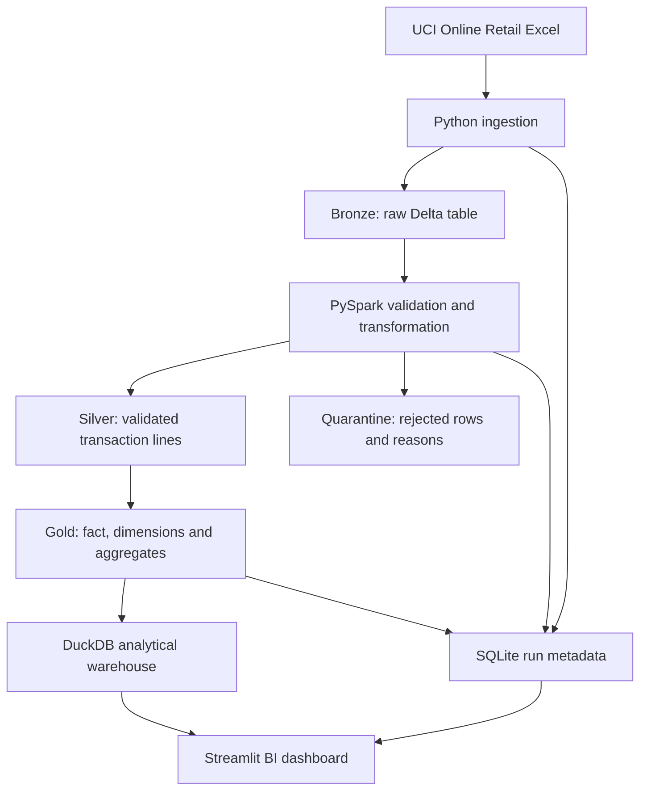

# CommerceFlow — E-Commerce ETL & Business Intelligence Platform

## 1. Objective

Build a fully functional, portfolio-ready Python data engineering application demonstrating ETL/ELT, PySpark, SQL, Delta Lake, medallion architecture, dimensional modelling, data quality, orchestration and business intelligence. Target a one-hour MVP using Google Antigravity. Use only free local/open-source tools; no paid APIs, cloud resources, payment credentials or subscriptions. Prioritize a working pipeline and real analytics over cosmetic extras.

## 2. Technology stack

- Frontend: Streamlit, Plotly, custom CSS for visual styling.
- Backend: Python, PySpark, Spark SQL, Delta Lake, DuckDB.
- Orchestration: Python CLI and subprocess-based pipeline runner.
- Operational metadata: SQLite (Python standard library).
- Tests: pytest.
- Environment: Python 3.11, Java 17, PySpark 3.5.3, delta-spark 3.2.1. Check local compatibility before installing; pin tested dependencies in requirements.txt. Delta Lake requires compatible JVM dependencies and may need internet access on the first run.
- Optional cloud demonstration: Databricks Free Edition notebook; no Azure deployment required. Do not describe local orchestration as Azure Data Factory.

## 3. Data source

Use the free UCI Online Retail dataset: https://archive.ics.uci.edu/dataset/352/online-retail (541,909 transaction lines). Download the original Excel file from the repository, or accept a local copy via CLI. Use pandas/openpyxl to convert Excel to CSV for Spark ingestion. Cache the downloaded file locally; never silently substitute synthetic data. Include source attribution and dataset license information in README. Support `--sample-rows 50000` for fast initial runs and full dataset mode by default. Do not commit the raw dataset to Git.

Source fields: InvoiceNo, StockCode, Description, Quantity, InvoiceDate, UnitPrice, CustomerID, Country. Dataset does not contain payment methods, product categories, shipping costs, inventory levels, or website traffic; do not invent them.

## 4. Architecture



Use a local filesystem for Lakehouse storage. Keep transformation logic independent from the UI. The dashboard must query the warehouse and operational metadata, not recalculate business metrics from raw Excel.

## 5. Backend requirements

### 5.1 Ingestion and Bronze

- Implement `python -m pipelines.run --source data/raw/online_retail.xlsx` and optional `--sample-rows N`, `--download` arguments.
- Validate required column names before processing; fail with a useful error if columns are missing.
- Preserve source values in Bronze, with source file hash, source row number, ingestion timestamp and run ID. Use explicit schemas and deterministic row identifiers based on file hash and source row number.
- Store Bronze as Delta; use overwrite of the selected input snapshot, not blind append. Record whether the run used sample or full data.

### 5.2 Silver and data quality

- Normalize names to snake_case; trim strings; parse dates explicitly; use decimal monetary types, integer quantities and string identifiers.
- Treat missing invoice, stock code, country, invalid date, unparseable quantity/price, zero quantity and negative price as rejected rows. Preserve raw values and reason codes in quarantine. Multiple reasons may apply to one row; count rejected rows once.
- Keep missing customer IDs as unknown customers, not fabricated IDs; retain valid sales with missing descriptions and display an unknown product description when necessary.
- Flag exact repeated business rows and report their count; retain by default because identical lines may represent legitimate purchases. Do not mistake repeated pipeline runs for duplicate source rows.
- Classify invoice numbers beginning with C or negative quantities as returns/cancellations. Keep them separate from gross sales, using absolute line value for return totals. Treat zero-price lines as valid but flag them for review.
- Calculate line amount from quantity and unit price using decimal arithmetic. Keep accepted, rejected and flagged counts distinct. Verify Bronze count = Silver accepted count + quarantine count.

### 5.3 Gold and warehouse

Create a star schema in Delta and publish corresponding DuckDB tables:

| Table | Grain / columns |
|---|---|
| fact_transactions | One accepted source line; row_id, invoice_no, product_key, customer_key, date_key, country, quantity, unit_price, gross_amount, return_amount, is_return |
| dim_product | One stock code; deterministic latest nonempty description |
| dim_customer | One customer identifier plus unknown member |
| dim_date | One calendar date; year, month, quarter, day |
| agg_daily_sales | One date; gross sales, returns, net sales, orders |
| agg_country_sales | One country; gross sales, returns, net sales, orders |
| agg_product_sales | One product; gross sales, returns, net sales, units |

- Build using PySpark and Spark SQL. Store Gold tables in Delta; export Gold tables to Parquet for DuckDB ingestion rather than collecting large datasets into pandas.
- Create DuckDB tables/views with SQL scripts. Publish a new warehouse snapshot only after reconciliation and validation pass; use staged output and atomic replacement after closing connections. Preserve the previous successful warehouse if a run fails.
- Use one pipeline writer at a time (cross-process lock); release lock on exit. Prevent duplicate data on reruns of the same input. Keep run-specific Lakehouse output paths and metadata so the UI displays the last successfully published snapshot.
- Verify fact row count equals accepted Silver count, dimension keys are unique, foreign keys resolve and aggregate net sales reconcile to fact totals.

### 5.4 Pipeline orchestration and API boundary

- Stages: ingest → validate/clean → transform → gold → warehouse → verify/publish.
- Implement reusable functions with typed arguments, structured logging and meaningful exceptions. Exit nonzero on failure.
- SQLite run records: run_id, source, source_hash, sample_rows, start/end timestamps, status, stage, duration, input/accepted/rejected/flagged counts, error summary and published snapshot path.
- Record stage-level start/end/status and row counts; maintain pipeline logs per run.
- Streamlit Run Pipeline starts the CLI as a subprocess, records the run ID, prevents concurrent runs and displays actual progress from SQLite. Refresh status without restarting the job. Do not use shell=True or interpolate user input into shell commands.
- UI reads warehouse through a separate query service using read-only DuckDB connections and parameterized filters. Close connections after queries. Clear relevant UI caches when the published run changes.
- No separate REST server, authentication or microservices needed for the MVP.

## 6. Frontend design

Create an attractive, cohesive enterprise analytics interface named **CommerceFlow**. Use Streamlit native components with CSS styling; do not create a separate React frontend. Avoid fake charts, placeholder metrics, decorative buttons or excessive explanatory text.

### Visual system

| Element | Color |
|---|---|
| Main background | #F5F7FB |
| Cards | #FFFFFF |
| Sidebar | #10243A |
| Primary | #2563EB |
| Teal accent | #0D9488 |
| Text | #172B4D |
| Muted text | #64748B |
| Borders | #E2E8F0 |
| Success | #15803D |
| Warning | #B45309 |
| Error | #B91C1C |

Use a dark navy sidebar, clean white cards, subtle shadows, 12px card corners, 16–24px spacing, readable 14–16px body text and 28–32px KPI numbers. Use a consistent sans-serif font stack and high-contrast labels. Plotly charts should use coordinated blue/teal colors, restrained gridlines, hover tooltips and responsive widths. Support desktop and mobile using Streamlit responsive layout. Keep navigation labels short and consistent.

### Navigation and pages

**Overview**
- Header: page title, last successful refresh timestamp, sample/full dataset indicator.
- Global date range and country filters; apply to all business charts and KPIs on analytics pages. Provide reset filters.
- KPI cards: net revenue, gross revenue, total orders, known customers, average order value and return value. Use three cards per row on desktop where practical.
- Daily/monthly revenue trend, top 10 products by net revenue, country revenue bar chart, gross sales vs returns chart.
- Recent transaction table with pagination or a clearly labelled limited preview.

**Sales Analytics**
- Sales trends by day/month, country and product.
- Top products by revenue and units sold; display net units separately if implemented.
- Orders and average order value over time.
- Return value and return-to-gross-sales ratio; handle zero denominators.
- Download filtered aggregate results as CSV.

**Customer Analytics**
- Known customer count, repeat customers, repeat purchase rate, top customers by net revenue.
- Customer segmentation using order frequency and net revenue; use simple documented thresholds rather than ML.
- Exclude unknown customer IDs from customer-specific metrics; disclose this in a short tooltip.
- Apply date and country filters consistently.

**ETL Pipelines**
- Run Pipeline button, source selection (download or existing local file), sample/full selector and refresh control.
- Display actual pipeline stage status, timestamps and duration.
- Execution history table, selected run details, counts and errors.
- Show logs for the selected run and allow text download. Disable Run while a run is active.

**Lakehouse Explorer**
- Bronze, Silver and Gold tabs with real table names, schema, record counts and limited data previews.
- Quarantine preview with rejection reasons.
- Read metadata and query tables via backend functions; never load all rows into the browser.

**Data Quality**
- Input, accepted, rejected and flagged row counts for the selected run.
- Acceptance rate = accepted / input; rejection reasons chart, missing customer count, repeated row flags, zero-price count and validation check results.
- Rejected records table and downloadable CSV.
- Explicitly distinguish overlapping quality flags from mutually exclusive accepted/rejected totals.

**SQL Analytics**
- Provide predefined SQL queries: monthly revenue, top products, country sales, repeat customers and returns.
- Display SQL text, Run Query button, result table and CSV download. Only execute predefined read-only queries with parameterized filters; arbitrary SQL editor is not required.

### Metric definitions

- Gross revenue: sum of positive sale line amounts excluding returns/cancellations.
- Return value: sum of absolute return/cancellation line amounts.
- Net revenue: gross revenue minus return value. Label currency GBP (£).
- Orders: distinct non-return invoice numbers.
- Known customers: distinct non-null customer IDs on sale lines.
- Average order value: gross revenue / sale orders; show N/A if no orders.
- Repeat customers: known customers with at least two distinct sale invoices within the selected filters.
- Repeat purchase rate: repeat customers / known customers.
- All date filters include both boundary dates. Display empty states instead of misleading zeros when no data is loaded; distinguish genuinely zero values from unavailable metrics.

## 7. Project structure

```text
commerceflow/
├── app.py
├── config.py
├── requirements.txt
├── README.md
├── .gitignore
├── pipelines/
│   ├── __init__.py
│   ├── run.py
│   ├── ingestion.py
│   ├── validation.py
│   ├── transformation.py
│   ├── warehouse.py
│   └── metadata.py
├── services/
│   ├── analytics.py
│   ├── pipeline_service.py
│   └── lakehouse_service.py
├── views/
│   ├── overview.py
│   ├── sales.py
│   ├── customers.py
│   ├── pipelines.py
│   ├── lakehouse.py
│   ├── quality.py
│   └── sql_analytics.py
├── assets/styles.css
├── sql/analytics.sql
├── notebooks/databricks_etl.ipynb
├── tests/test_pipeline.py
└── data/  # generated locally; raw, runs, logs, metadata
```

## 8. Implementation order

1. Check Python and Java, install pinned dependencies and verify a small Spark/Delta write-read operation. Start dataset acquisition immediately.
2. Implement ingestion, validation, Bronze/Silver/Gold and quarantine. Run a small real-data sample and verify counts.
3. Implement DuckDB schema, metrics, run metadata, locking and successful snapshot publication. Verify rerun safety.
4. Build shared navigation, styles, filters and Overview; connect to real warehouse results.
5. Add Sales, Customers, Pipelines, Lakehouse, Data Quality and SQL Analytics using reusable query and UI components. Prioritize simple functional views over complex design effects.
6. Run tests, launch Streamlit and verify interactions. Document only actual implemented features and known limitations.

If Spark/Delta setup blocks the MVP, offer an explicitly labelled local DuckDB/Parquet fallback with the same medallion semantics. Keep the Spark implementation separate and do not claim Delta or Spark execution until verified. Do not silently switch technologies.

## 9. Verification and delivery

- Test parsing, missing required columns, rejected rows, unknown customers, returns, repeated source rows, count reconciliation and metric calculations with a tiny deterministic fixture.
- Test a real dataset sample end-to-end, then rerun and verify identical fact counts and totals. Try full data if time permits.
- Verify failed runs preserve the previous published warehouse; dashboard handles empty data and invalid filters without crashing.
- Verify navigation, filters, CSV downloads, pipeline launch and log display. No nonfunctional controls.
- Provide a concise README with architecture, dataset attribution, metric definitions, actual setup/run commands, screenshots if available, test results and limitations.
- Include a Databricks-compatible notebook demonstrating Bronze/Silver/Gold PySpark transformations, using configurable workspace storage paths. Document mapping: local storage → ADLS Gen2; local Spark → Azure Databricks; Python orchestration → Azure Data Factory; DuckDB → cloud analytical warehouse; Streamlit → BI layer. This is a proposed migration, not a deployed Azure solution.
- Run commands from the project root (Windows-compatible):

```powershell
python -m venv .venv
.\.venv\Scripts\python.exe -m pip install -r requirements.txt
.\.venv\Scripts\python.exe -m pipelines.run --download --sample-rows 50000
.\.venv\Scripts\python.exe -m pytest -q
.\.venv\Scripts\python.exe -m streamlit run app.py
```

Implement directly in the current workspace. Do not generate extra planning documents, unrelated modules, mock analytics or placeholder pages. At completion, report what actually runs, test results, exact launch commands and any unfinished features or blockers. A one-hour target is a priority, not a reason to claim unverified completion.
